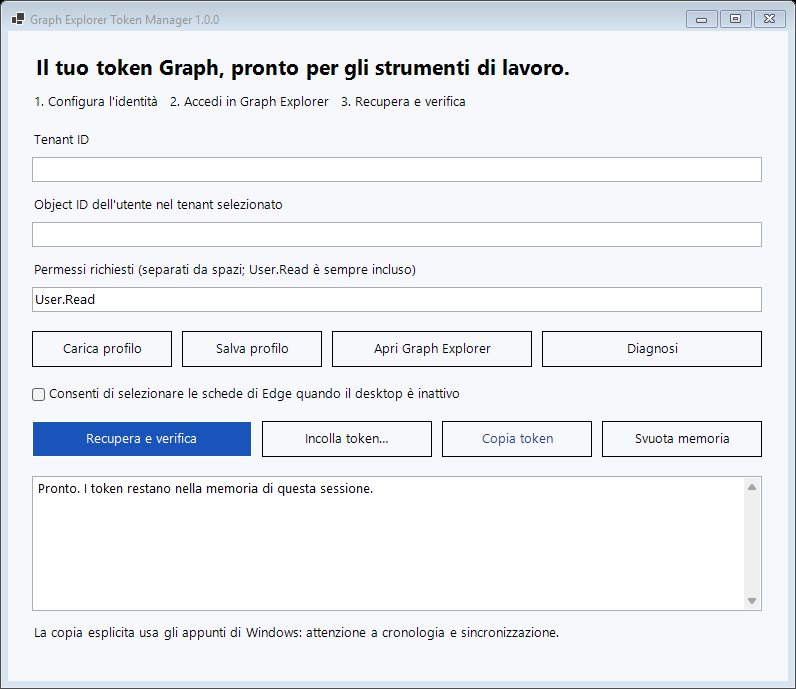

# Graph Explorer Token Manager

[](https://github.com/alesmecca/graph-explorer-token-manager/actions/workflows/ci.yml)

Recupera il tuo access token da **Microsoft Graph Explorer**, verifica l'identità prevista con Microsoft Graph e usalo nei tuoi strumenti. Interfaccia Windows, CLI e modulo PowerShell; nessun account preconfigurato e nessun token salvato su disco.

**Versione 1.0.0 · Windows 10/11 · PowerShell 7.4+ · Microsoft Edge in italiano o inglese.**



## Avvio rapido

1. Scarica lo ZIP dalla pagina [Releases](https://github.com/alesmecca/graph-explorer-token-manager/releases) ed estrailo completamente, oppure clona il repository.
2. Installa [PowerShell 7](https://learn.microsoft.com/powershell/scripting/install/installing-powershell-on-windows) se `pwsh` non è disponibile.
3. Avvia **Start-GraphExplorerTokenManager.cmd**.
4. Inserisci **Tenant ID**, **Object ID dell'utente** e permessi richiesti. Puoi salvarli come `profile.local.json`.
5. Premi **Apri Graph Explorer**, accedi con l'account previsto e seleziona **Access token**. Lascia la pagina visibile in una sola finestra Edge.
6. Premi **Recupera e verifica**. Quando la verifica riesce puoi usare **Copia token** per trasferirlo al tuo client REST.

Tenant ID e Object ID si trovano nel portale Microsoft Entra. Per un account guest usa l'Object ID nel tenant di destinazione. La casella *Consenti di selezionare le schede* autorizza soltanto la selezione dei pannelli della pagina Graph Explorer già visibile, dopo almeno tre secondi di inattività. Le schede inattive del browser vanno aperte manualmente.

Il programma non esegue login, MFA, scelta account o consenso. Se l'interfaccia di Edge cambia, **Incolla token** offre un campo nascosto e applica gli stessi controlli di identità e scadenza.

## Profilo riutilizzabile

Copia `examples/profile.example.json` in `profile.local.json` e sostituisci gli identificativi fittizi:

```json
{
  "TenantId": "11111111-1111-4111-8111-111111111111",
  "AccountObjectId": "22222222-2222-4222-8222-222222222222",
  "RequiredScopes": ["User.Read"],
  "MinimumValiditySeconds": 180
}
```

`User.Read` è sempre richiesto per verificare `/me`. Gli scope aggiuntivi sono controllati esattamente: inserirli nel profilo non concede permessi. Il margine di scadenza è configurabile da 30 a 600 secondi nel modulo e nella CLI; la GUI usa 180 secondi. I file `*.local.json` sono esclusi da Git.

## CLI

Dalla cartella del progetto:

```powershell
pwsh -NoProfile -File ./scripts/Invoke-TokenManager.ps1 -Action Diagnose
pwsh -NoProfile -File ./scripts/Invoke-TokenManager.ps1 -Action Open
pwsh -NoProfile -File ./scripts/Invoke-TokenManager.ps1 -Action Connect -ProfilePath ./profile.local.json
# Consenti la selezione del pannello Access token nella pagina già visibile:
pwsh -NoProfile -File ./scripts/Invoke-TokenManager.ps1 -Action Connect -ProfilePath ./profile.local.json -AllowInteraction
# Alternativa: input interattivo nascosto, mai token nella riga di comando:
pwsh -NoProfile -File ./scripts/Invoke-TokenManager.ps1 -Action Connect -ProfilePath ./profile.local.json -Manual
```

La CLI restituisce JSON con soli metadati; exit code `0` per successo, `2` per errore gestito. Ogni invocazione chiude la propria cache. Usa il modulo nello stesso processo per integrare il token con altri script.

## Modulo PowerShell

```powershell
Import-Module ./src/GraphExplorerToken/GraphExplorerToken.psd1
$settings = Get-Content ./profile.local.json -Raw | ConvertFrom-Json -AsHashtable
$profile = New-GraphExplorerProfile @settings

Connect-GraphExplorerToken -Profile $profile
Get-GraphExplorerTokenInfo -Profile $profile

$token = Get-GraphExplorerToken -Profile $profile # copia SecureString
try {
    # PowerShell 7 accetta SecureString per l'autenticazione Bearer.
    $me = Invoke-RestMethod -Method Get `
        -Uri 'https://graph.microsoft.com/v1.0/me?$select=id,displayName' `
        -Authentication Bearer -Token $token -MaximumRedirection 0
    $me
} finally {
    $token.Dispose()
    Clear-GraphExplorerToken -Profile $profile
}
```

Per l'inserimento manuale usa `Read-Host -AsSecureString`, poi `Connect-GraphExplorerToken -Profile $profile -Token $inputToken` e disponi il valore di input con `.Dispose()`. `-Force` forza una nuova acquisizione e verifica. Nessuna funzione pubblica restituisce il bearer in chiaro.

La cache distingue tenant, utente, scope e margine. `Connect` riusa una verifica vecchia al massimo cinque minuti se il token conserva il margine richiesto. `Get-GraphExplorerToken` verifica la scadenza ma non contatta Graph: un token può essere revocato nel frattempo. Chiudere il processo o chiamare `Clear-GraphExplorerToken` cancella la cache locale, senza revocare la sessione Microsoft.

## Sicurezza e limiti

La lettura usa soltanto controlli visibili di una pagina HTTPS Graph Explorer la cui origine è verificata nella barra di Edge. Non usa cookie, database browser o cronologia. La modalità predefinita è passiva. L'adattatore vive in un processo separato, terminato al timeout; non è un servizio persistente.

I metadati JWT controllano preliminarmente audience, tenant, utente, scope e durata. **La decodifica non verifica la firma.** Prima di salvare il token in memoria, il programma esegue esclusivamente `GET https://graph.microsoft.com/v1.0/me?$select=id`, senza redirect, e verifica l'ID restituito. Microsoft Graph valida il token ricevuto. Questo controllo non prova l'autorizzazione alle altre API.

Il token resta in memoria, con conversioni temporanee in chiaro necessarie alla richiesta HTTP e alla copia esplicita. Non sono conservati refresh token. La copia negli appunti è una scelta dell'utente: cronologia e sincronizzazione di Windows possono conservarla e **gli appunti non vengono cancellati automaticamente**.

Questa versione supporta token JWT leggibili, account delegati e cloud globale Microsoft. I token opachi producono `unsupported_token_format`. L'automazione dipende dai controlli esposti da Edge e Graph Explorer; non può garantire compatibilità con ogni aggiornamento o policy aziendale. Il controllo automatico non cerca schede browser inattive o finestre minimizzate.

È uno strumento interattivo per sviluppo e amministrazione. Per un'applicazione di produzione o un processo senza operatore usa una tua registrazione applicativa e MSAL. Il progetto è indipendente da Microsoft. Vedi [SECURITY.md](SECURITY.md) e [risoluzione dei problemi](docs/troubleshooting.md).

## Verificare e distribuire

```powershell
pwsh -NoProfile -File ./scripts/Test.ps1
pwsh -NoProfile -File ./scripts/Build-Release.ps1
```

I test offline usano token sintetici, HTTP simulato e controlli dell'origine; verificano anche costruzione GUI e sintassi. Non aprono il browser e non contattano un tenant. Il collaudo reale resta distinto: [procedura e copertura](docs/testing.md). La CI esegue lo stesso runner su Windows. La build riesegue i test e produce ZIP e SHA-256 in `artifacts/` senza profili locali.

## Riferimenti ufficiali

- [Graph Explorer: pannello Access token](https://learn.microsoft.com/en-us/graph/graph-explorer/graph-explorer-features)
- [Microsoft Identity: formati e validazione dei token](https://learn.microsoft.com/en-us/entra/identity-platform/access-tokens)
- [Microsoft Graph: GET user e /me](https://learn.microsoft.com/en-us/graph/api/user-get?view=graph-rest-1.0)

Licenza [MIT](LICENSE). Vedi [CHANGELOG.md](CHANGELOG.md) per le modifiche.
